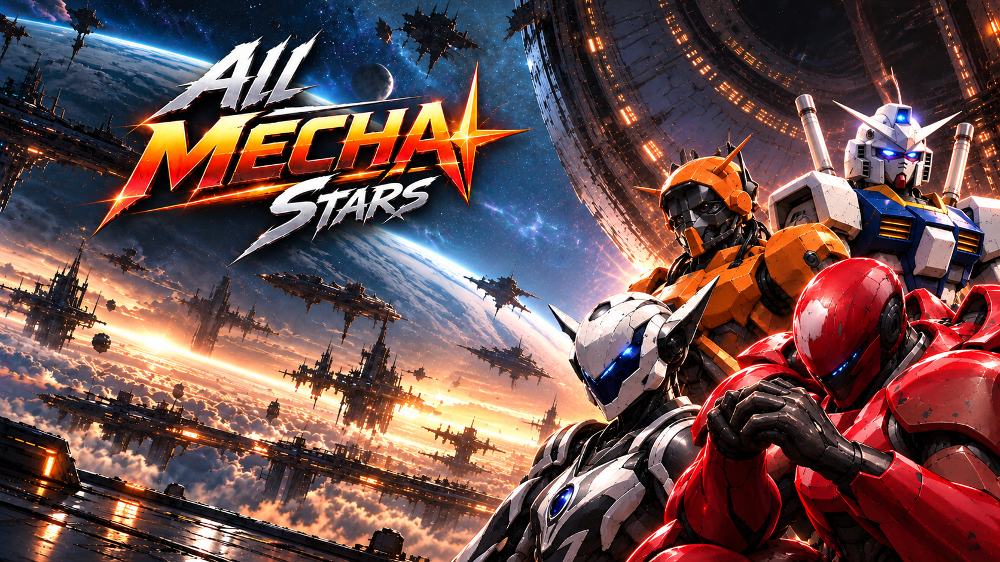

# ⚔️ All Mecha Stars

**All Mecha Stars** é um jogo de luta 1v1 feito com HTML, CSS e JavaScript, com quatro mechas 3D, golpes, esquivas, combos e batalhas contra a CPU.

## ⬇️ BAIXAR O JOGO

### **[🎮 BAIXAR — Releases](https://github.com/paulogallo-gif/All_Mecha_Stars/releases)**

Acesse o link acima, escolha a versão desejada e baixe o arquivo **.zip** na seção **Assets** da versão.

## 🚀 Como jogar

1. Extraia o ZIP baixado.
2. Abra a pasta do jogo no **Visual Studio Code**.
3. Instale a extensão **Live Server**, caso ainda não tenha.
4. Abra o arquivo `index.html` com **Open with Live Server**.
5. Clique para iniciar, escolha seu mecha e entre na arena!

## 🕹️ Controles

| Tecla | Ação |
|---|---|
| **A / D** ou **← / →** | Movimentar |
| **Dois toques para frente** | Correr |
| **Dois toques para trás** | Esquiva / dash |
| **W / Espaço** | Pular / pulo duplo |
| **J** | Ataque leve |
| **K** | Ataque pesado |
| **U** | Golpe adicional |
| **L / S** | Defender |
| **O** | Esfera Azul (Vega) |
| **Esc** | Pausar |
| **R** | Reiniciar luta |
| **F** | Tela cheia |
| **H** | Mostrar hitboxes (diagnóstico) |

## 🤖 Personagens

🔴 **Red Acrobatics** · 🟠 **Fast Maneuver** · 🔵 **Mecha** · ⚪ **Vega**

## 📖 História

Em um futuro dominado por máquinas de combate, quatro guerreiros mecânicos entram na arena para provar quem merece o título de maior lutador do universo. Cada um traz seu estilo, seus movimentos e sua própria força.

---

*Projeto em desenvolvimento. Novas animações, habilidades e melhorias estão a caminho.*

#JOGO 2

# ⚔️ ANIME CROSS ARENA

**Anime Cross Arena** é um jogo de luta 2D para Windows, desenvolvido com o motor **IKEMEN GO**, inspirado nos clássicos jogos de combate de anime.

Escolha seu lutador, enfrente adversários e prove sua força na arena!

## 🎮 BAIXAR O JOGO

📥 **[BAIXAR PELO GITHUB RELEASES](../../releases)**

### 💻 Como instalar e jogar

1. Acesse a seção de **Releases**.
2. Baixe o ZIP do jogo para Windows.
3. Extraia todos os arquivos para uma pasta.
4. Abra a pasta extraída.
5. Execute o arquivo `.exe` principal do jogo.
6. Escolha seu personagem e comece a batalha!

> **Importante:** não execute o jogo diretamente dentro do ZIP. Mantenha as pastas e os arquivos junto ao executável.

## 🕹️ CONTROLES

- **Movimentação:** andar, pular e agachar.
- **Ataques:** socos, chutes e golpes especiais.
- **Defesa:** bloquear ataques adversários.
- **Menu:** selecionar, confirmar e voltar.

Os comandos podem variar conforme as configurações do IKEMEN GO e do personagem selecionado.

## 📖 HISTÓRIA

Guerreiros de diferentes universos são reunidos em uma arena misteriosa.

Sem conhecer os responsáveis pelo torneio, cada lutador enfrenta adversários cada vez mais poderosos para descobrir a verdade e alcançar o confronto final.

**Apenas os mais fortes conquistarão a vitória!**

## ⚙️ INFORMAÇÕES

| Informação | Detalhes |
|---|---|
| 🎮 Gênero | Luta 2D |
| 💻 Plataforma | Windows |
| ⚙️ Motor | IKEMEN GO |
| 📦 Formato | ZIP com executável |
| 🚧 Estado | Em desenvolvimento |

## 🛠️ DESENVOLVIMENTO

Anime Cross Arena é um projeto em desenvolvimento.

Futuras atualizações poderão incluir novos personagens, cenários, melhorias de combate e correções de bugs.

*Obrigado por jogar Anime Cross Arena!*

